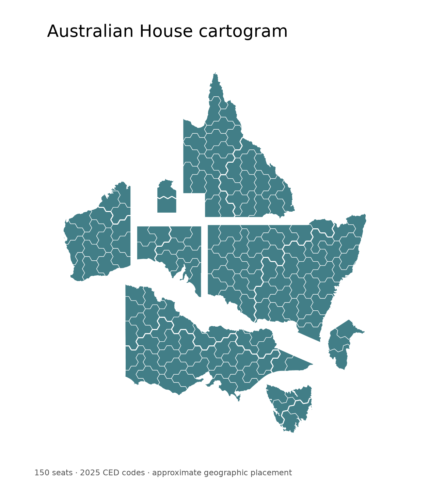

# Aus Cartograms

Reusable **150-seat Australian House of Representatives cartogram polygons**, with official **2025 ABS CED codes and names**, separate AEC DivisionIDs and approximate geographic placement.

[GitHub repository](https://github.com/adrasyn/aus-cartograms)



## Download

- [GeoPackage](data/australian_house_cartogram.gpkg) — recommended; `electorates` and `states` layers.
- [Zipped shapefile](data/australian_house_cartogram_shapefile.zip) — extract every companion file together; UTF-8 names.
- [Attributes / identifier crosswalk](data/ced_crosswalk.csv).
- [CSV with WKT geometry](data/australian_house_cartogram_wkt.csv).

**Coordinates are in a local diagram space with an undefined CRS, not longitude/latitude.** Use them for cartogram visualisation; geographic transformations, distances and spatial overlays require actual geographic boundaries.

## Identifiers

`CED_CODE` and `CED_NAME` are taken directly from **ABS CED2025** (`CED_CODE25`, `CED_NAME25`). Codes are stored as strings and must be interpreted with `VINTAGE = "2025"`.

`AEC_ID` is the **separate national AEC DivisionID**, also stored as a string. For example, **Banks is CED_CODE `101`, AEC_ID `103`**. All 150 codes and names are matched one-to-one against the official ABS source. Match the identifier scheme and 2025 vintage when joining other datasets.

| Field | Meaning |
|---|---|
| `CED_CODE`, `CED_NAME` | Official ABS 2025 CED identifier and name |
| `AEC_ID` | National AEC DivisionID; different code scheme |
| `STATE`, `VINTAGE` | State abbreviation and electoral-geography vintage |
| `METRO`, `AEC_CLASS` | 1 for AEC Inner/Outer Metropolitan; 0 for Provincial/Rural; original classification retained |
| `AREA_RATIO`, `AREA_ERR` | Seat area / target area, and percentage deviation |
| `NOM_HEX` | Target area expressed in full hexagons; five per seat |
| `LAYOUT` | `geographic` — approximate geographic placement |

Shapefile field names are at most 10 characters, and a UTF-8 `.cpg` preserves electorate names. Its undefined diagram CRS is represented by the absence of a `.prj` file.

## Python

```python
import geopandas as gpd
seats = gpd.read_file("data/australian_house_cartogram.gpkg", layer="electorates")
assert len(seats) == 150 and seats["CED_CODE"].is_unique
assert seats.crs is None
seats.plot(color="#427E87", edgecolor="white", linewidth=0.4)
# Your data should use string, 2025-vintage CED codes:
# seats = seats.merge(values, on="CED_CODE", validate="one_to_one")
```

## R

```r
library(sf)
library(ggplot2)
seats <- st_read("data/australian_house_cartogram.gpkg", layer = "electorates")
# Some GDAL versions expose an "Undefined SRS" Cartesian placeholder.
# Clear the placeholder for plotting while preserving diagram coordinates.
seats <- st_set_crs(seats, NA)
stopifnot(nrow(seats) == 150L, !anyDuplicated(seats$CED_CODE), is.na(st_crs(seats)))
ggplot(seats) +
  geom_sf(fill = "#427E87", colour = "white", linewidth = 0.15) +
  coord_sf(datum = NA) + theme_void()
# Join your data by CED_CODE, stored as character, using the 2025 code vintage.
```

Validation covers Python/GeoPandas and GDAL shapefile round trips, plus GeoPackage and UTF-8 shapefile imports with R 4.6.0, `sf` 1.1.3 and GDAL 3.8.5. Both import tests preserve all 150 official CED codes/names and separate AEC IDs. See [validation results](docs/validation.json), [Python tests](tests/validate.py) and [R tests](tests/validate.R).

## Coverage and accuracy

- Coverage: the 150 Commonwealth Electoral Divisions in the ABS 2025 vintage.
- State areas are proportional to seats: NSW 46, VIC 38, QLD 30, WA 16, SA 10, TAS 5, ACT 3 and NT 2.
- Seat areas vary because internal edges follow clipped hexagonal cells. `AREA_RATIO` and `AREA_ERR` record each seat's deviation from its target area; the maximum absolute deviation is approximately 11.10%.
- Electorate placement and adjacency are approximate within state and AEC metropolitan/non-metropolitan regions. Expanded metropolitan regions displace some coastal seats inland. These synthetic shapes are **not official electoral boundaries**.
- Silhouettes use simplified **ABS ASGS2021 State/Territory** coastlines. Small offshore islands are omitted and interior holes filled; ACT is displayed separately.
- GDA2020 source geometry is projected, resized and translated into diagram space. Display projections use standard parallels of 25°S generally and 42°S for Tasmania.

See [methods](docs/methods.md), [source attribution](docs/sources.md) and [validation](docs/validation.json).

## Reproduction

```sh
python -m pip install -r requirements.txt
python scripts/build_exports.py       # export stored geometry to GPKG / SHP / CSV
python scripts/reassign_geographic.py # assign names using ABS geographic anchors
python scripts/preview.py             # render the cartogram
python tests/validate.py
Rscript tests/validate.R
```

The `source/` directory contains the released geometry, clipped hexagonal cells, placement slots, ABS geographic anchors and identifier crosswalks. The scripts reproduce the exports and geographic name assignment from these stored inputs. Optional `scripts/refresh_abs_anchors.py` downloads checksum-verified official ABS sources and regenerates anchors.

## Licence and citation

Code is licensed under [MIT](LICENSE). Data and the cartogram image are licensed under [CC BY 4.0](LICENSES/DATA-CC-BY-4.0.md), with attribution to James Wilson and the Australian Bureau of Statistics. AEC classification and identifier tables are separately attributed in [sources](docs/sources.md). The cartograms are modified, synthetic works; attribution does not imply ABS or AEC endorsement.

Please cite the version and 2025 CED vintage; machine-readable citation metadata is in [CITATION.cff](CITATION.cff).
